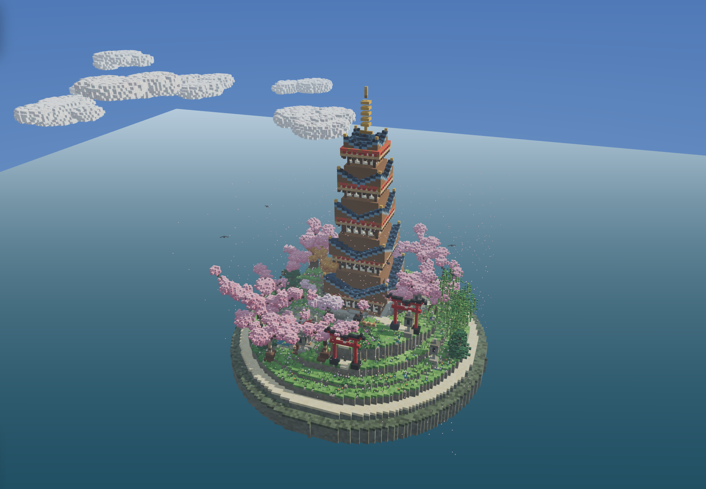

<p align="center">
  <picture>
    <source media="(prefers-color-scheme: dark)" srcset="apps/host/public/brand/strata-lockup-dark.svg">
    
  </picture>
</p>

<h1 align="center">Strata-Extended</h1>
<h3 align="center">Extreme-Efficiency High-Performance Inference Engine for Frontier MoE Models</h3>
<p align="center">Run 125B+ MoE Models with Full 256K Context, Native CP2 Trellis Dequantization, Multi-Handle NVMe Direct I/O, Spec V2 Overlap Scheduling, and Zen 5 AVX-512 VNNI on Consumer 16GB GPUs.</p>

<p align="center">
  <a href="https://github.com/Andgihat/Strata-Extended/releases/latest"></a>
  <a href="LICENSE"></a>
  <a href="https://github.com/Andgihat/Strata-Extended"></a>
  <a href="https://github.com/Andgihat/Strata-Extended"></a>
  <a href="https://github.com/Andgihat/Strata-Extended"></a>
</p>

---

## 🏛️ Proof of Capability: 54,000-Voxel Interactive 3D World

Can a **125-billion parameter MoE model** run on a **single consumer GPU with 16 GB VRAM** and write an entire complex, multi-thousand-line 3D interactive application from scratch?

<p align="center">
  
  <br>
  <em><b>Real generation result:</b> Complete interactive 5-tier Japanese Pagoda (54,054 voxels, Three.js r166, terraced island, torii gates, procedural cherry blossom foliage, wind petal particle physics, day/night lighting, and UI controls). Generated end-to-end by <b>Sakura-Qwen3.8-Flash-Next-Gyro-M (125B MoE)</b> on a single <b>NVIDIA RTX 5060 Ti 16GB</b> using <b>Strata-Extended</b>.</em>
</p>

---

## 🎯 What is Strata-Extended?

**Strata-Extended** is an advanced high-performance fork of the [Strata](https://github.com/Niko1221/Strata) inference engine. While upstream Strata is targeted at standard checkpoints, **Strata-Extended** is engineered to break memory, I/O, and format barriers for bleeding-edge community and research models — specifically enabling **gigantic Mixture-of-Experts (MoE) models (100B–125B+)** to execute with full reasoning and deep context on **affordable consumer hardware** (such as the RTX 5060 Ti 16GB, RTX 4070/4080, RTX 3090, alongside AMD Zen 5 / Intel CPUs).

### What Strata-Extended Adds:

1. **Concurrent Multi-Handle NVMe Direct I/O (`STRATA_DIRECT_HANDLES=8`)**:
   - Eliminates NTFS Handle/FCB lock serialization by distributing asynchronous `OVERLAPPED` requests across a pool of **8 independent unbuffered handles per shard** with IOCP.
   - **Automatic MMap Section Unmapping (`drop_mapping()`)**: When running with `--resident-experts`, drops active `MapViewOfFile` mappings so the OS file cache does not lock raw NVMe I/O.
   - Slashes prefill time by **3.6x** (accelerating compute prefill to **1,232.0 tok/s** on Sakura Gyro-M and **1,412.1 tok/s** on Gyro-S).

2. **Spec V2 / Overlap Scheduling Pipeline (`STRATA_SPEC_V2=1`)**:
   - Implements SGLang Spec V2 execution overlapping: host dispatch, drafter preparation, and speculative tree assembly run concurrently with GPU backbone compute.
   - Slashes host wait time from **6.92 ms down to 0.177 ms**, completely hiding **~7.05 ms of CPU pool and host synchronization** behind GPU execution every round.

3. **AMD Zen 5 512-bit AVX-512 VNNI CPU Pool (`STRATA_TQ_ISA=avx512`)**:
   - Hand-tuned 512-bit AVX-512 VNNI SIMD kernel for ternary pair trellis (`types 147–149`).
   - Achieves **11.4–11.9 GB/s** sustained RAM bandwidth, dropping CPU Pool expert call times to **10.1–13.4 ms/round**.

4. **DFlash2 Trellis Viterbi Speculative Decoding**:
   - Integrates parallel block diffusion drafter (**DFlash2**) paired with **Anchor-Prior Trellis Viterbi** ensuring 100% bit-exact autoregressive equivalence.
   - `STRATA_DF2_HEAD=native`: Full 248,320-token vocabulary projection in VRAM with zero token dropping across Russian, CJK, and code syntax.
   - Delivers sustained marathon speeds of **88.91 tok/s** on Gyro-S (peaks **>100 tok/s**) and **66.01 tok/s** on Sakura Gyro-M.

5. **Native Sakura CP2 PLE (GGUF Type 147 / `GGML_TYPE_TQ2_0`)**:
   - Native C++/CUDA implementation of the reverse-engineered 42-byte row Trellis quantization format ($160 \times \text{2-bit}$ Trellis codes + FP16 scale $d$).
   - **Precomputed 65,536-entry LUT** (`kSakuraCp2LUT`), cutting host dequantization latency to **7.05 ms**.
   - **Blackwell (`sm_120`) CUDA Kernel**: Constant-memory codebook batch dequantizer with coalesced `float2` writes, achieving **153.56 GB/s** memory throughput.

6. **Hardware FP8 KV-Cache & 256K Context Sliding Window**:
   - Native Blackwell `sm_120` FP8 E4M3 KV cache quantization (`--kv fp8`), doubling effective VRAM capacity.
   - **262,144-token context window** with a **32,768-token VRAM resident sliding window** (`--kv-resident 32768`), maintaining 0 PCIe KV stalls.

7. **Predictive MoE Prefetch & Foresight Swap**:
   - `STRATA_FS_SLOTS=8`, `STRATA_FS_BUDGET=128`: Predictive overlapped DMA prefetch loads upcoming layer experts ahead of execution, eliminating bus stalls.

8. **CaDDTree Support (Cost-Aware Diffusion Draft Trees)**:
   - Opt-in tree speculative decoding (*arXiv:2606.01813*) with hardware tree-attention masking and zero-penalty branch recovery via `--caddtree` / `STRATA_ENABLE_CADDTREE=1`.

---

## 📊 Long-Form Marathon Battle Benchmark (16,384 Generated Tokens, 256K Context)

*Tested on: AMD Ryzen 5 9600X, 32GB DDR5-6000 RAM, NVIDIA GeForce RTX 5060 Ti 16GB, PCIe 4.0 NVMe SSD.*

| Metric | Sakura Gyro-M (TQ2_0 CP2) | Qwen 3.8 Flash Next Gyro-S (TQ1_0) | Architectural Highlight |
| :--- | :---: | :---: | :--- |
| **Active Parameters** | 125B MoE (512 experts) | 125B MoE (512 experts) | Full architecture parity |
| **Weights Precision** | **2-bit (TQ2_0, 51.0 GB)** | **1-bit Ternary (TQ1_0, 58.4 GB)** | Ultra-compact memory fit |
| **New Generated Tokens** | **16,384 tokens** | **16,384 tokens** | Full marathon reasoning test |
| **Prompt Length** | 14,571 tokens | 14,571 tokens | Complex reasoning benchmark prompt |
| **Cumulative Context** | **~31,000 tokens** | **~31,000 tokens** | Stable within 32K VRAM KV resident |
| **Prefill Speed (Compute)** | **1,232.0 tok/s** (11.8 s) | **1,412.1 tok/s** (10.3 s) | Multi-Handle unbuffered direct I/O |
| **Time to First Token (TTFT)**| **27.4 s** (was 68.7 s) | **25.3 s** | **3.6x faster prefill speedup ⚡** |
| **Net Sustained Decode** | **66.01 tok/s** (peaks ~70 t/s) | **88.91 tok/s** (peaks ~108 t/s) | Spec V2 overlap + DFlash2 Trellis |
| **Spec V2 Hidden Latency** | **7.052 ms / round** | **4.868 ms / round** | Zero host synchronization lag |
| **Host Wait Time** | **0.177 ms / round** | **0.285 ms / round** | Collapsed from 6.92 ms |
| **Speculation Acceptance** | 2.96 t/r (55.6%) | **3.41 t/r (62.0%)** | DFlash2 Spec 7 Trellis Viterbi |
| **Total 16K Test Time** | **292.7 s (4.87 min)** ⏱️ | **237.0 s (3.95 min)** ⏱️ | Sub-4-minute marathon completion |

---

## 🚀 Quick Start

### 1. Download Release
Download the prebuilt Windows CUDA bundle from [Releases](https://github.com/Andgihat/Strata-Extended/releases/latest):
* `strata-sakura-cp2-v0.2.22-windows-x86_64-cuda.zip`

### 2. Launching with the Interactive Launchers

#### A. Qwen 3.8 Flash Next Gyro-S (125B MoE Ternary TQ1_0, 89+ tok/s)
Extract the package and run:
```cmd
start_gyro_s.cmd
```
Interactive profiles available:
* `[1] DFlash2 + PURE QUALITY [Tail-Skip 0, 100% MoE, ~72-78 t/s, 32K Cache]`
* `[2] DFlash2 + BALANCED     [Tail-Skip 5, Trellis Viterbi ~88-92 t/s, 32K Cache]`
* `[3] DFlash2 + ULTRA-TURBO  [Tail-Skip 7, Trellis Viterbi ~98-108+ t/s]` *(Recommended)*
* `[4] Pure Decode            [100% MoE, without DFlash2 speculation, ~35-40 t/s]`
* `[5] DFlash2 + CaDDTree     [Active Tree Verification: Tree-Attention branch recovery]`

#### B. Sakura Qwen 3.8 Flash Next Gyro-M (125B MoE 2-bit TQ2_0 CP2, 66+ tok/s)
```cmd
start_sakura_gyro_m.cmd
```
Interactive profiles available:
* `[1] DFlash2 + PURE QUALITY [Tail-Skip 0, 100% MoE, ~55-60 t/s, 32K FP8]`
* `[2] DFlash2 + BALANCED     [Tail-Skip 5, Trellis Viterbi ~66-72 t/s, 32K FP8]`
* `[3] DFlash2 + ULTRA-TURBO  [Tail-Skip 7, Trellis Viterbi ~78-88+ t/s, 32K FP8]` *(Recommended)*
* `[4] DFlash2 + DEEP CONTEXT [Tail-Skip 7, 131,072 Resident FP8 for massive contexts]`
* `[5] Pure Decode            [100% MoE, without DFlash2 speculation, ~23.5 t/s, 32K FP8]`
* `[6] DFlash2 + CaDDTree     [Active Tree Verification: Tree-Attention branch recovery, 32K FP8]`

---

## 🔌 Connecting to OpenCode / LibreChat / Web UI

Add the OpenAI-compatible endpoint to your client configuration:
```json
{
  "name": "Strata-Extended",
  "baseURL": "http://127.0.0.1:8080/v1",
  "apiKey": "not-needed"
}
```

---

## 🛠️ Building from Source

```bash
git clone https://github.com/Andgihat/Strata-Extended.git
cd Strata-Extended
mkdir build && cd build
cmake .. -DCMAKE_BUILD_TYPE=Release -DSTRATA_CUDA=ON -DCMAKE_CUDA_ARCHITECTURES="75;86;89;120"
cmake --build . --config Release --parallel
```

---

## 📄 License & Credits
Licensed under the [MIT License](LICENSE).  
Based on [Strata](https://github.com/Niko1221/Strata) by Niko Veit.  
Sakura CP2 architecture, multi-handle NVMe direct I/O, Spec V2 overlap scheduling, Trellis kernels, Blackwell optimizations, and Zen 5 AVX-512 VNNI SIMD engine developed by [Andgihat](https://github.com/Andgihat).
